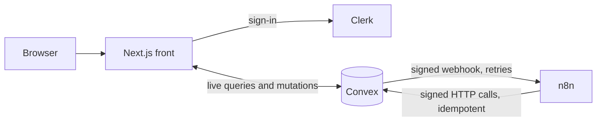

# LendLoop

A neighbourhood tool-lending board. Neighbours list tools they are willing to lend, request to borrow from each other for a date range, and get automatic notifications and overdue reminders through n8n.

**Stack:** Next.js (App Router) and TypeScript, Clerk (sign-in), Convex (data and back-end logic), n8n (automation), Tailwind.

## What you can do
- **Visitor:** see a public list of available tools (name and category only, no owner details).
- **Signed-in user:** list, edit and delete your own tools; request a tool for a date range; approve or decline requests on your tools; mark a loan as returned; follow everything in *My listings*, *My requests* and *Incoming requests*.
- **Admin:** remove any listing, see all loans, mark a lender as *Trusted Lender*.
- **Automation:** every request or status change notifies the right person; a daily job reminds borrowers whose loan is overdue.

## Architecture

- `front/`: screens and components. No business rule lives here.
- `back/convex/`: a **modular monolith**. Each module (`users`, `tools`, `loans`, `automation`) has `domain.ts` (pure rules), `queries.ts` / `mutations.ts` (thin Convex functions) and its tests in `back/tests/<module>/`. `shared/` holds the access guards, error types and HMAC signing.
- `n8n/`: the three workflows (JSON), a `docker-compose.yml` and a setup guide.

### Why these choices
- **Rules in pure functions** (`domain.ts`): they can be tested without a database, and the Convex functions stay short and readable.
- **One place for access control** (`shared/auth.ts`): every function starts with `requireUser` or `requireAdmin`, so a check is hard to forget. The role is stored and decided on the server, never sent by the client.
- **One place for status changes** (`loans/mutations.ts`, `act`): approve, decline, cancel and return share one transition table, so the rules cannot drift apart.
- **Overdue is computed, not stored**: a loan is late when it is approved and its end date has passed. No job has to keep a status in sync.
- **No double booking, by design:** every Convex mutation is a serializable transaction. The overlap check and the status change happen in the same transaction, so if two approvals race, one commits and the other is retried, sees the first booking and is refused. The same rule protects against a double click on *Request* and against a duplicate automation write-back. Tests fire these calls at the same time.
- **Notifications are scheduled, not inline**: the loan is saved first, then Convex tells n8n. A slow n8n never blocks the user.

## Security
- **Server-side access control** on every function (owner, lender, borrower, admin). Tests cover the forbidden cases.
- **Signed integration in both directions:** HMAC-SHA256 of `timestamp.body`, messages older than 5 minutes are refused (limits replay), constant-time comparison.
- **Input validation on every function:** Convex argument validators check types and ids, and the domain rules check lengths, allowed categories and conditions, and dates. Quotas limit mistakes and abuse: at most 50 tools per user, 10 pending requests per borrower, no duplicate request for the same dates, and loans of at most 90 days.
- **Secrets** are environment variables (Convex environment, `n8n/.env`, `front/.env.local`), never in the code or in the exported workflows.
- **Idempotency:** each automation record has a unique key, so a retry never creates a duplicate reminder or journal entry.
- **Failures are visible:** Convex retries 3 times then records `failed`; n8n retries HTTP calls and an error workflow reports failed runs back to Convex; the app shows the last automation event on each loan.

## Data minimization
- The public page exposes only tool name and category.
- The payload sent to n8n holds only: event, loan id, recipient name and email, tool name, other party name and dates. No user ids, tokens or descriptions.
- The admin user list never includes sign-in tokens.
- Tools are soft-deleted, so loan history stays available for audit.

## Tests and CI
- 77 back-end tests (Vitest and convex-test): domain rules, access control, loan lifecycle, overlapping bookings, signatures, retries, idempotency, HTTP endpoints.
- GitHub Actions runs the back-end typecheck and tests and the front-end typecheck and build on every pull request.

## Run it locally
Prerequisites: Node 22, Docker Desktop.
1. **Clerk:** create an application, activate the Convex integration, and in *Sessions > Customize session token* add `"email": "{{user.primary_email_address}}"` and `"name": "{{user.full_name}}"` next to the existing `aud` claim.
2. **Back-end:** `cd back && npm install && npx convex dev`, then set the Convex environment:
   ```
   npx convex env set CLERK_JWT_ISSUER_DOMAIN https://YOUR-APP.clerk.accounts.dev
   npx convex env set ADMIN_EMAILS you@example.com
   ```
3. **Front-end:** `cd front && cp .env.example .env.local`, fill in the Clerk keys, then `npm install && npm run dev` (http://localhost:3000).
4. **Automation (optional):** follow `n8n/README.md`, then:
   ```
   npx convex env set AUTOMATION_SECRET <same value as n8n/.env>
   npx convex env set N8N_WEBHOOK_URL http://localhost:5678/webhook/lendloop-loan-events
   ```
   Without these two settings automation stays off and nothing leaves Convex.
5. **Tests:** `cd back && npm test`.

### Environment variables
| Where | Name | Purpose |
|---|---|---|
| Convex | `CLERK_JWT_ISSUER_DOMAIN` | Verifies Clerk sign-in tokens |
| Convex | `ADMIN_EMAILS` | Emails that become admin on first sign-in |
| Convex | `AUTOMATION_SECRET` | Shared HMAC secret with n8n |
| Convex | `N8N_WEBHOOK_URL` | Where Convex sends notifications |
| `front/.env.local` | `NEXT_PUBLIC_CONVEX_URL`, `NEXT_PUBLIC_CLERK_PUBLISHABLE_KEY`, `CLERK_SECRET_KEY` | Front-end connection |
| `n8n/.env` | `AUTOMATION_SECRET`, `CONVEX_SITE_URL` | Used by the n8n workflows |

## Known limits
- **No pagination yet:** lists load in full, which is fine at neighbourhood scale (and each user is limited to 50 tools). In production they would use Convex pagination (`paginate` on the server, `usePaginatedQuery` in the screens).
- **No photo upload:** tool images are generated placeholders. Next step: Convex file storage with type and size checks, and the placeholder when no photo is set.
- **Connection loss:** an offline banner appears, and Convex reconnects on its own. An error page lets the user retry if a screen fails.
- Notifications are logged mock nodes in n8n; swap them for Send Email, Slack or Discord with an n8n credential.
- See `docs/PRODUCTION.md` for what would change in production.
